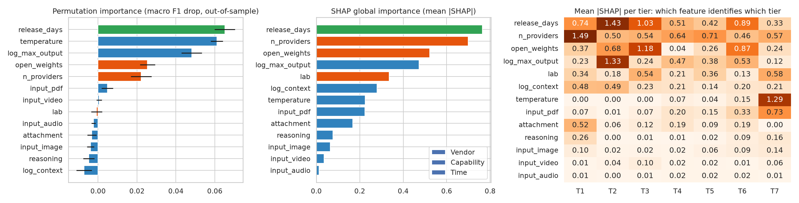
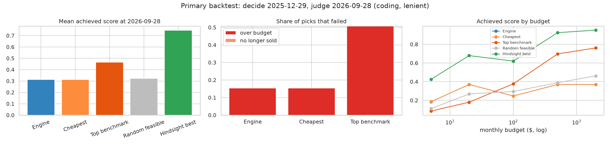

# LLM Price Classifier

**Classifying the 2026 LLM API Market: Price Tiers, Price Trends, and Budget-Based Model Selection**

ICT324 Introduction to Data Warehousing and Data Mining, Rangsit University International College
Team Straw Hats: Mr. Nyi Ye Naing (6703332). Supervisor: Asst. Prof. Dr. Kritsada Sriphaew (Ajarn KonG)

How can LLM API models be grouped into price/performance tiers and price-trend classes, and how can those classes help someone pick a model on a budget, now and in the near future?

The project follows CRISP-DM. Clustering creates tier labels, classifiers assign tiers and price trends, and a rule-based decision algorithm turns both into a model recommendation, which is also served as a small REST API.

## Research questions and results

| RQ | Hypothesis | Method | Result |
|---|---|---|---|
| **RQ1** Tiers | H1: at least 3 distinct tiers, including one with high price but no matching benchmark advantage | Ward hierarchical vs K-means on log price + composite performance | **Supported.** k = 7 tiers. T6 "High-price / Mid-performance" (Claude Sonnet 4.6, Gemini 3.1 Pro Preview, …) costs more than T5 and T2 but performs worse. |
| **RQ2** Tier classification | H2a: classifier beats the majority baseline. H2b: non-performance features (lab, open weights) rank among the top features | Decision Tree vs Random Forest vs XGBoost, nested repeated 5×10 CV, SHAP | **H2a supported:** XGBoost macro F1 0.34 vs 0.05 majority (permutation p ≈ 0.01). **H2b partial:** open_weights ranks 3rd (SHAP), lab 5th; release date ranks 1st. |
| **RQ3** Trend classification | H3: classifier trained on earlier weeks beats the "no change" baseline on later weeks | DT vs RF vs XGBoost on price-history features, time-based split | In progress (notebook 03). |
| **RQ4** Model selection | H4: picks give better value than "pick cheapest" and "pick top benchmark" | Filter-then-rank decision algorithm, backtest (decide at 2025-12-29, check at 2026-09-28) | **Not supported.** Score ÷ cost collapses to "cheapest" (mean achieved score 0.31 vs 0.46 for top benchmark). An exploratory budget-aware **score-first** rule reaches 0.57, beating both, but still needs a pre-registered test. |

### RQ4 decision algorithm

Input: task, requirements, expected monthly input/output tokens, monthly budget.

1. Filter by task capability (coding, reasoning, vision, function calling, JSON output)
2. Filter by requirements (min context, open-weight only, include/exclude labs, min score, release recency)
3. Filter by budget: expected tokens × price ≤ budget
4. Rank by value (score ÷ cost) or by score within budget
5. Adjust for price trend: falling trends rank up, rising trends rank down
6. Return the top 3 with their tier and trend

## Data

Two Kaggle datasets by the same author:

- [AI Models Pricing & Price History 2023–2026](https://www.kaggle.com/datasets/abirambharathisa/ai-models-and-api-pricing-2026-price-history): pricing catalog (4,403 rows) and weekly price history (167,787 rows, 2023-09-18 to 2026-09-28)
- [LLM Benchmarks & Specs 2026](https://www.kaggle.com/datasets/abirambharathisa/llm-benchmarks-and-specs-2026-448-ai-models): 448 models, 1,082 benchmark results, 8,427 provider offerings

The two datasets share no key, so models are joined by normalized name (143 of 147 tiered models matched to a price series). Raw files are **not** in this repo; see [`data/raw/README.md`](data/raw/README.md) for where to put them. The cleaned outputs in `data/processed/` **are** committed, so notebooks 01–04 and the API run without the raw data.

Main cleaning steps (notebook 00): keep text LLMs only, drop regional duplicates and null prices, merge benchmark spelling variants (180 → 168), revert one-week price spikes, flag >10× jumps, forward-fill internal gaps. All 49 validation checks pass (`data/processed/validation_report.csv`).

## Repository layout

```
├── data/
│   ├── raw/                 Kaggle CSVs + ai_models.db (not committed)
│   └── processed/           clean data and per-RQ outputs (committed)
├── notebooks/
│   ├── 00_data_validation_cleaning.ipynb
│   ├── 01_RQ1_tier_clustering.ipynb
│   ├── 02_RQ2_tier_classification.ipynb
│   └── 04_RQ4_model_selection.ipynb      (03 is reserved for RQ3)
├── reports/figures/         plots written by the notebooks
├── src/llm_recommender/     RQ4 engine as a FastAPI service
└── requirements.txt
```

| Output | From | Used by |
|---|---|---|
| `clean_*.csv`, `validation_report.csv` | 00 | everything else |
| `rq1_tiers.csv`, `rq1_tier_profiles.csv` | 01 | 02, 04, API |
| `rq2_cv_results.csv`, `rq2_feature_importance.csv` | 02 | report |
| `rq4_backtest_results.csv`, `rq4_summary.csv`, `rq4_mapping.csv` | 04 | report |
| `recommender_snapshot.json` | `src/llm_recommender/build_snapshot.py` | API |

## Running

The notebooks are Colab-compatible (they ask for file uploads in Colab) and also run locally from `notebooks/` with [uv](https://docs.astral.sh/uv/):

```bash
cd notebooks
uv run --with pandas,numpy,scipy,scikit-learn,matplotlib,seaborn,nbconvert,ipykernel \
  jupyter nbconvert --to notebook --execute --inplace 01_RQ1_tier_clustering.ipynb
```

- Notebook 00 needs the raw data in `data/raw/`.
- Notebook 02 also needs `xgboost,shap` and takes about 7 minutes.
- Notebook 04 runs in about 1 minute.

Alternatively, `pip install -r requirements.txt` and use Jupyter as usual. Random seeds are fixed, so results are reproducible.

### Recommender API

```bash
uv run --with pandas python src/llm_recommender/build_snapshot.py      # rebuild snapshot (optional)
uv run --with fastapi,uvicorn uvicorn llm_recommender.api:app --app-dir src --port 8000
# docs at http://localhost:8000/docs

curl -s localhost:8000/recommend -H 'content-type: application/json' -d '{
  "task": "coding", "monthly_input_tokens_m": 100, "monthly_output_tokens_m": 20,
  "monthly_budget_usd": 200, "requirements": {"open_only": true}, "rank_by": "score"
}'
```

Endpoints: `/health`, `/meta`, `/models`, `/models/{model_id}`, `POST /recommend`. `rank_by` is `score` (default, the exploratory rule) or `value` (the proposal's rule, which failed H4). Full details in [`src/llm_recommender/README.md`](src/llm_recommender/README.md).

## Figures

| RQ2 feature importance | RQ4 backtest (primary setting) |
|---|---|
|  |  |

## Limitations

- **Sparse benchmarks.** Only 157 of 448 models have any score, and the coverage matrix is 12.5% filled. Performance is a composite (mean within-test percentile over tests covering ≥5 models), and raw scores are never compared across benchmarks.
- **Era bias.** Older models are ranked against older peers, which likely explains why release date dominates RQ2. Restricting to recent models is a candidate fix.
- **Price aggregation.** RQ1 uses the median provider price (3:1 input:output blend); RQ4 and the API use the cheapest provider and exclude free tiers.
- **Trends.** Until RQ3 writes `rq3_trends.csv`, RQ4 and the API use a 12-week momentum placeholder, and the trend step changed 0% of backtest picks.

## References

- The Emerging Market for Intelligence: Pricing, Supply, and Demand for LLMs. NBER w34608. https://www.nber.org/papers/w34608
- Bergemann, Bonatti & Smolin. The Economics of Large Language Models. arXiv:2502.07736
- The Price of Intelligence: A Quality-Adjusted Price Index for AI Services. arXiv:2608.29843
- Chen, Zaharia & Zou. FrugalGPT. TMLR 2024. arXiv:2305.05176
- Epoch AI. LLM inference price trends. https://epoch.ai/blog/llm-inference-price-trends
